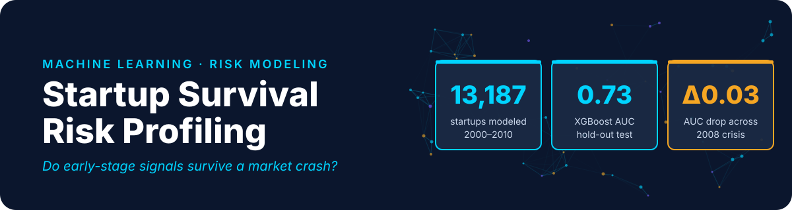
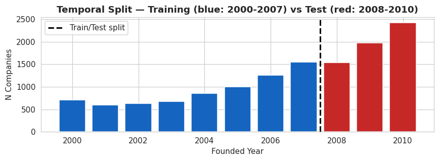
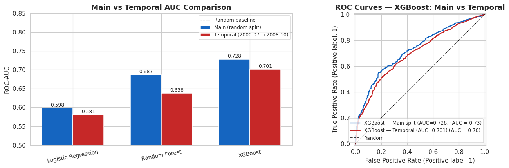
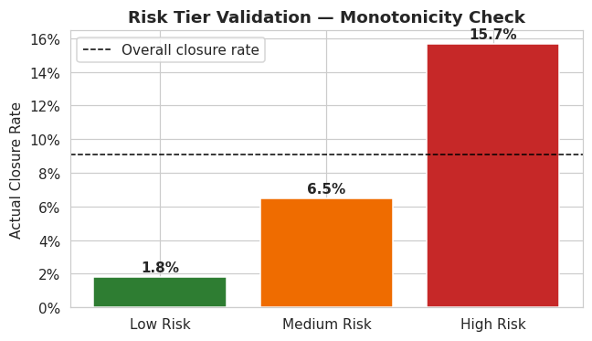
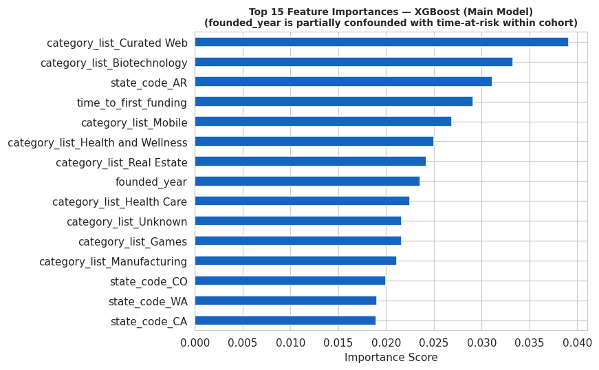

<p align="center">
  
</p>

<p align="center">
  Can a few signals you can see in a startup's first year tell you how risky it is?<br>
  And do those signals still work after a market crash?
</p>

<p align="center">
  
  
  
</p>

<p align="center">
  
</p>

---

## The question

Most startup-success models look great on paper because they cheat in two quiet ways:

1. **Data leakage.** They use features like total funding or number of rounds. Those are *results* of surviving, not early signals.
2. **Time bias.** A startup founded in 2013 and checked in 2015 had only 2 years to fail. It looks like a "survivor" just because it's young.

I wanted a model that avoids both and then passes a harder test: **train on startups from before the 2008 financial crisis, and test on startups founded during it.**

## My approach

| Decision | Why |
|---|---|
| **5-year cohort cutoff** | I found the dataset snapshot date from the data itself (latest funding date ≈ 2015). Then I kept only startups founded 5+ years before it, so every company had the same minimum time to fail. |
| **Early-stage features only** | Industry, state, founding year, time to first funding, and whether a startup got funded at all. I removed every funding total and round count because they leak the outcome. |
| **Dropped `region`** | It's built from `state_code`, so keeping both double-counts geography. |
| **Temporal test** | Train on 2000–2007, test on 2008–2010. This is a real out-of-time test, not just a random split. |
| **Risk tiers, not just AUC** | I turned predictions into Low / Medium / High risk tiers and checked that real closure rates increase from tier to tier. |

<p align="center">
  
</p>

## Results

**13,187 U.S. startups** founded 2000–2010 · closure rate 9.1%

| Model | 5-fold CV AUC | Hold-out AUC | Crisis-era AUC (2008–10) | Drop |
|---|---|---|---|---|
| Logistic Regression | 0.59 ± 0.02 | 0.60 | 0.58 | 0.018 |
| Random Forest | 0.68 ± 0.02 | 0.69 | 0.64 | **0.049** ⚠ |
| **XGBoost** | **0.71 ± 0.01** | **0.73** | **0.70** | **0.027** |

**Main finding:** XGBoost loses only about 0.03 AUC when it moves from pre-crisis to crisis-era startups. The early-stage signals mostly hold up through a major market shock. Random Forest drifts more, which suggests it fits patterns that are specific to one era.

<p align="center">
  
</p>

### Do the risk tiers mean anything?

Yes. Real closure rates rise in order across the tiers. High-risk startups closed almost **9× more often** than low-risk ones.

| Tier | Startups (test set) | Actual closure rate |
|---|---|---|
| Low risk | 601 | 1.8% |
| Medium risk | 985 | 6.5% |
| High risk | 1,052 | 15.7% |

<p align="center">
  
</p>

### What drives the predictions?

Industry is the strongest signal, followed by time to first funding. Because industry and state are one-hot encoded, their importance is spread over many small columns.

<p align="center">
  
</p>

## Limitations

- **Censored labels.** Startups still "operating" in 2015 count as survivors, but what happened to them later is unknown. When I removed them, AUC fell from 0.73 to 0.69. That's more than my 0.03 threshold, so the labeling choice does affect the results.
- **`founded_year` is partly confounded.** Inside the cohort, older startups had more time to fail before the snapshot.
- **Shallow features.** There's no data on team, product, or revenue, so AUC tops out in the low 0.70s.
- **Small groups add noise.** Some state dummies (for example `state_code_AR`) rank high in importance even though they have few companies.
- **Selection bias.** Crunchbase over-represents venture-backed startups.

## Run it

1. Download `big_startup_secsees_dataset.csv` from Kaggle: **[ADD KAGGLE LINK HERE]**
2. Put it next to the notebook.
3. Install the packages and open the notebook:
   ```bash
   pip install -r requirements.txt
   jupyter notebook startup_survival.ipynb
   ```
   It also runs on Google Colab. Upload the CSV to your session first.

## Repo

```
startup_survival.ipynb   full pipeline with saved outputs
docs/                    banner, slides GIF, result plots
requirements.txt
```

---

Built for ISyE 521: Machine Learning in Action (UW–Madison, Spring 2026) with Maggie Hannum and Lauren Vorpagel. I designed and built the full analysis pipeline.
